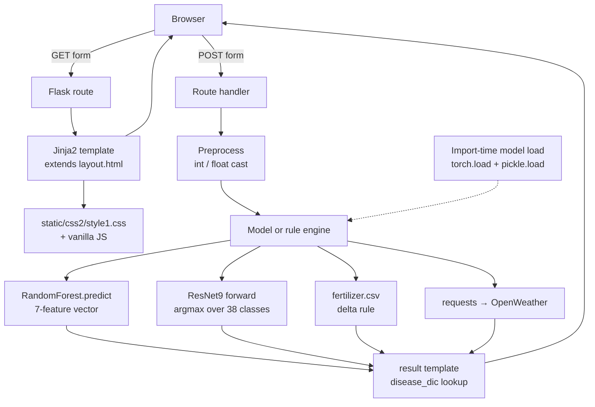

  # PREDICROP — Architecture & Design Specification

> Field-record styled precision-farming web app. Soil chemistry + weather → crop
> recommendation; soil chemistry → fertilizer advice; leaf image → disease
> detection; city → 5-day forecast.

---

## 1. Product Summary

PREDICROP is a single-page-per-feature Flask application that turns raw farm
inputs into an agronomic action. Four independent predictors run server-side and
each owns one route pair (form → result).

| Capability | Input | Model / Source | Output |
|---|---|---|---|
| Crop recommendation | N, P, K, city | `RandomForest.pkl` + OpenWeather | Best crop to sow |
| Fertilizer suggestion | N, P, K, crop | `fertilizer.csv` rule engine | Deficient/excess nutrient + fix |
| Disease detection | Leaf image | `plant_disease_model.pth` (ResNet9) | Crop + disease + remedy |
| Weather forecast | City | OpenWeather Geo + Forecast | Current conditions + 5 days |
| Soil information | — | Static editorial | N-P-K reference content |

---

## 2. Framework & Tech Stack

### Runtime
- **Python** 3.10 (venv at `app/.venv`; root `.venv` also provisioned)
- **Flask 3.1** — Jinja2 templates, no JS framework
- **Werkzeug** dev server on `127.0.0.1:5000`; **gunicorn** for Heroku

### Machine Learning
- **scikit-learn 1.2.2** — RandomForestClassifier (crop recommendation)
- **PyTorch 2.13 + torchvision 0.28 (CPU)** — ResNet9 (disease classification)
- **pandas 2.3 / numpy 1.24** — tabular lookup and model input assembly
- **Pillow 12** — image decode for uploads

### Frontend
- **Server-rendered Jinja2** with a single `layout.html` base template
- **Hand-written CSS** (`static/css2/style1.css`) — the only active stylesheet
- **Fraunces** (display serif) + **Work Sans** (UI/body), loaded from Google Fonts
- **Vanilla JS** — mobile nav toggle, weather fetch, upload preview
- **Google Translate** widget (12 Indian + global languages)
- Legacy `bootstrap.css`, `font-awesome.min.css`, `css/style.css`, `css2/style.css`
  and `css2/style1.css`'s predecessor remain on disk but are **not referenced**

### External Services
- OpenWeatherMap Geocoding `GET /geo/1.0/direct`
- OpenWeatherMap Current + 5-day/3-hour forecast `GET /data/2.5/forecast`
- Key injected via `app/config.py` (`weather_api_key`) and forwarded to templates

---

## 3. Directory Structure

```
predicrop/
├── DESIGN.md                  # this document
├── README.md                  # upstream project overview
├── requirements.txt           # full research env (notebook + training stack)
├── app/                       # ── deployable application ──
│   ├── app.py                 # routes, model loading, inference, business rules
│   ├── config.py              # secrets / API keys
│   ├── Procfile               # heroku: gunicorn app:app
│   ├── Runtime.txt            # heroku python pin
│   ├── requirements.txt       # slim runtime deps
│   ├── models/                # serialized inference artifacts
│   │   ├── plant_disease_model.pth     # ResNet9 state_dict (torch)
│   │   └── RandomForest.pkl            # sklearn pipeline
│   ├── Data/
│   │   └── fertilizer.csv     # per-crop target N/P/K
│   ├── utils/
│   │   ├── model.py           # ResNet9 definition + ConvBlock
│   │   ├── disease.py         # disease_dic: label → HTML remedy copy
│   │   └── fertilizer.py      # fertilizer_dic: key → HTML advice copy
│   ├── static/
│   │   ├── css2/style1.css    # ACTIVE design system
│   │   ├── scripts/cities.js  # city/state datalist for crop form
│   │   └── images/            # hero + feature photography
│   └── templates/
│       ├── layout.html        # base: nav, footer, fonts, translate
│       ├── index.html         # /
│       ├── crop.html          # /crop-recommend
│       ├── crop-result.html   # POST /crop-predict
│       ├── fertilizer.html    # /fertilizer
│       ├── fertilizer-result.html
│       ├── disease.html       # /disease-predict (GET)
│       ├── disease-result.html
│       ├── weather.html       # /weather
│       ├── more-info.html     # /addinfo
│       └── try_again.html     # shared failure state
├── Data-raw/                  # source CSVs (training lineage)
├── Data-processed/            # curated CSVs (fertilizer, crop_recommendation)
├── models/                    # training-time artifact mirror
└── notebooks/                 # data prep + training notebooks
```

**Convention:** everything under `app/` uses paths **relative to `app/`**, so
the process must be started with `app/` as the working directory.

---

## 4. Runtime Architecture



### Layer responsibilities

| Layer | Files | Responsibility |
|---|---|---|
| Presentation | `templates/*.html`, `static/css2/style1.css` | Markup, tokens, client-side only enhancement |
| Routing | `app.py` decorators | HTTP contract, input coercion, error branches |
| Inference | `app.py:predict_image`, `crop_recommendation_model` | Feature assembly → prediction |
| Domain rules | `app.py:fert_recommend` | Target-minus-actual delta → advisory key |
| Content | `utils/disease.py`, `utils/fertilizer.py` | HTML remedy copy keyed by class |
| Architecture | `utils/model.py` | ResNet9 graph definition |
| Integration | `app.py:weather_fetch`, `weather_api` | OpenWeather calls |
| Persistence | `models/*.pkl|pth`, `Data/fertilizer.csv` | Frozen artifacts, read-only at runtime |

### Lifecycle notes
- Models load **once at import time** (`app.py:63-73`). Any change to `.pkl`/`.pth`
  requires a process restart.
- `disease_model.eval()` disables dropout/BN updates — inference is stateless.
- Inference runs synchronously on the Flask worker thread. CPU-only ResNet9 on a
  256px leaf is fast enough for POC traffic but is not horizontally scalable
  without moving to a task queue.

---

## 5. HTTP Contract

| Method | Route | Endpoint | Behaviour |
|---|---|---|---|
| GET | `/` | `home` | Landing page |
| GET | `/crop-recommend` | `crop_recommend` | Soil + city form |
| POST | `/crop-predict` | `crop_prediction` | Requires `nitrogen, phosphorous, pottasium, ph, rainfall, city`; renders `crop-result.html`, or `try_again.html` when weather lookup fails |
| GET | `/fertilizer` | `fertilizer_recommendation` | N/P/K + crop form |
| POST | `/fertilizer-predict` | `fert_recommend` | Requires `cropname, nitrogen, phosphorous, pottasium`; renders `fertilizer-result.html` |
| GET/POST | `/disease-predict` | `disease_prediction` | GET renders upload form; POST with `file` renders `disease-result.html`, bare POST re-renders the form |
| GET | `/weather` | `weather` | Forecast shell + API key |
| GET | `/api/weather?city=` | `weather_api` | JSON `{city, forecast[]}`; 400 missing city, 404 unknown city, 500 no key, 503 upstream failure |
| GET | `/addinfo` | `addinfo` | Soil knowledge page |

Field names are **misspelled by contract** (`phosphorous`, `pottasium`) and must
not be renamed without updating both the templates and `app.py`.

---

## 6. Design System

### 6.1 Concept

A **field record / agronomy ledger** — parchment paper, ink, furrow rules, a
wheat-gold accent. Not a SaaS dashboard: no gradients, no glassmorphism, no
shadows, no card-inside-card nesting. Structure is communicated by dashed
"furrow" rules, parchment tone shifts, and stamp-style labels rather than boxes
and elevation.

### 6.2 Colour tokens — `static/css2/style1.css`

```
Surface     --parchment        #F3EFDF   page base
            --parchment-light  #FAF7EC   raised sheet
            --parchment-deep   #EAE4CF   recessed band
Ink         --ink              #23291D   primary text
Accents     --forest           #33502B   brand, primary actions
            --forest-deep      #233C1D   hover / footer
            --soil             #7A5233   secondary accent
            --soil-light       #9A7350
            --wheat            #C99A34   accent, focus, active nav
Rules       --furrow           1px dashed --ink-22
            --furrow-strong    1px dashed --ink-45
            --furrow-soil      1px dashed --soil-30
            --hairline         1px solid  --ink-14
```

Alpha ladder for ink: `--ink-14`, `--ink-22`, `--ink-45` (and soil equivalents).
Wheat has a matching `--wheat-40` for rule variants.

### 6.3 Typography

- **Display / headings** — Fraunces (optical size axis, 300–700). Fluid:
  `h1: clamp(2.2rem, 1.2rem + 3.2vw, 3.6rem)`, `h2: clamp(1.6rem, 1rem + 1.9vw, 2.4rem)`, `h3: 1.2rem`.
- **Body / UI / forms** — Work Sans (300–600).
- `--serif` / `--sans` custom properties hold the fallback stacks; always
  reference the token, never the raw family name.

### 6.4 Layout tokens

```
--shell   1180px   max content width (.container)
--gutter  28px     → 20px under the mobile breakpoint
--stack   1px      hairline rhythm
--nav-h   76px     navbar height
--tick    7px      furrow dash rhythm
```

### 6.5 Component vocabulary

Structural: `.container` · `section` · `.sheet` · `.furrow` (+ `--soil`,
`--strong`, `--wheat`) · `.duotone` (duotone image treatment)

Type: `.eyebrow` · `.stamp` · `.section-heading` · `.figure-caption`

Chrome: `.predicrop-navbar` · `.predicrop-brand` + `.brand-mark` · `.predicrop-nav`
· `.nav-link[aria-current="page"]` (wheat underline via `::after`) ·
`.predicrop-footer` · `.dropdown`

Actions: `.primary-btn` · `.secondary-btn` · `.prediction-submit` ·
`.result-button` (+ `.primary` / `.secondary`) · `.upload-button` ·
`.info-button` · `.service-link`

Data & results: `.form-grid` → `.form-field` (+ `.full-width`) ·
`.result-card` → `.result-eyebrow` / `.crop-name` / `.prediction-result` ·
`.insight-grid` → `.insight-card` · `.recommendation-box` ·
`.recommendation-content` · `.result-note` · `.result-actions`

Weather: `.weather-search-card` · `.weather-search` · `.city-input` ·
`.search-btn` · `.location-btn` · `.current-weather` · `.forecast-grid` →
`.forecast-card` · `.weather-message` (+ `.error`)

Content: `.soil-section` · `.soil-options` → `.soil-option` ·
`.numbered-list` · `.faq-card` → `.faq-list` · `.try-again-page`

### 6.6 Rules for contributors

1. **No new raw colours.** Add a token in `:root` and reference it. Inline
   `style="color:#..."` and per-component hex literals are both forbidden.
2. **One stylesheet.** `css2/style1.css` is the source of truth. Do not add a
   fourth CSS file; extend tokens and existing component classes instead.
3. **Extend `layout.html`.** Every feature template starts with
   `` and fills `` / ``.
   Never duplicate nav or footer markup.
4. **Active state via `request.endpoint`.** `layout.html` sets
   `` and each nav item compares
   against its endpoint list. New routes must be added to the relevant list or
   the nav will not highlight.
5. **No shadows.** `style1.css` contains zero `box-shadow` declarations by
   design — depth comes from parchment tone shifts (`--parchment-light` on
   `.sheet`, `.result-card`) and dashed `.furrow` rules. Do not add one.
6. **Reminders are opt-in.** Wrap any animation in
   `@media (prefers-reduced-motion: reduce) { … }`.
7. **Responsive breakpoints** (mobile-first overrides): 1080, 980, 860, 560 px.

---

## 7. Model Specifications

### 7.1 Crop recommendation — RandomForest
- Artifact: `app/models/RandomForest.pkl`
- Feature vector (order-sensitive, `numpy` `int` array):
  `[N, P, K, temperature °C, humidity %, pH, rainfall mm]`
- Temperature and humidity come from `weather_fetch(city)`; if the city is
  unresolvable the user is routed to `try_again.html` rather than shown a
  degraded prediction.
- `state` (`stt`) is collected in the form but intentionally unused.

### 7.2 Disease detection — ResNet9
- Architecture: `utils/model.py` — 4 conv blocks, 2 residual blocks
  (128×128×128, 512×512×512), `MaxPool(4)` + `Flatten` + `Linear(512, 38)`.
- Preprocessing: `Resize(256)` → `ToTensor()` → `unsqueeze(0)`. No
  normalisation — the training notebook is the contract.
- Output: raw logits, `argmax` over the 38-entry `disease_classes` list in
  `app.py:23-60`. **Reordering this list silently breaks every prediction.**
- Content: `utils/disease.disease_dic[class_label]` → HTML remedy block.

### 7.3 Fertilizer rule engine
1. Look up the crop's target N/P/K in `Data/fertilizer.csv`.
2. Compute `delta = target − actual` per nutrient.
3. The nutrient with the largest absolute delta determines the advisory.
4. Sign of the delta selects `*low` (deficient) or `*High` (excess).
5. `utils/fertilizer.fertilizer_dic[key]` → HTML advice.

---

## 8. Run & Deploy

```powershell
# from the app/ directory
.\.venv\Scripts\python.exe app.py          # http://127.0.0.1:5000
```

```bash
# Heroku (repo root of the deploy branch)
gunicorn app:app
```

`app/requirements.txt` targets Python 3.6 with pinned CPU torch wheels for
Linux; the local venv runs 3.10 with modern versions.

---

## 9. Known Constraints

| Area | Issue | Impact |
|---|---|---|
| Pickle compatibility | Artifacts serialised with scikit-learn 0.23.2, runtime is 1.2.2 | Loads with a `UserWarning`; retrain if predictions look wrong |
| Torch loading | `torch.load` defaults to `weights_only=True` on torch ≥ 2.6 | Fine for the current state_dict; breaks for pickled full models |
| Weather coupling | Crop recommendation fails closed without an OpenWeather key | Users hit `try_again.html` |
| Blocking inference | Models run on the request thread | No timeout, no queue; scale-out needs a worker |
| Error handling | `disease_prediction` swallows exceptions with a bare `except: pass` | Malformed uploads silently re-render the form |
| Secrets | API key is committed in `config.py` | Must move to an env var before any public deploy |
| Repo hygiene | Legacy `css/style.css`, `css2/style.css`, `bootstrap.css`, `font-awesome` are unreferenced | Dead weight; remove after visual regression check |
| Naming | `phosphorous` / `pottasium` field names | Do not "fix" without a migration |

---

## 10. Extension Points

- **New predictor** — add the artifact under `app/models/`, load it at import
  time, add the `utils/<feature>.py` content dict, add form + result templates
  that extend `layout.html`, register the routes, then extend the nav and footer
  lists in `layout.html`.
- **New advisory dimension** (e.g. soil moisture) — extend the feature vector in
  `crop_prediction` **and** retrain `RandomForest.pkl`; the two must ship together.
- **Move secrets to env** — read `os.environ["OPENWEATHER_KEY"]` in `config.py`
  with the current literal as a local-dev fallback.
- **Async inference** — wrap the model calls in a task queue and return a
  progress token; the result templates already render a `result-card` shell.